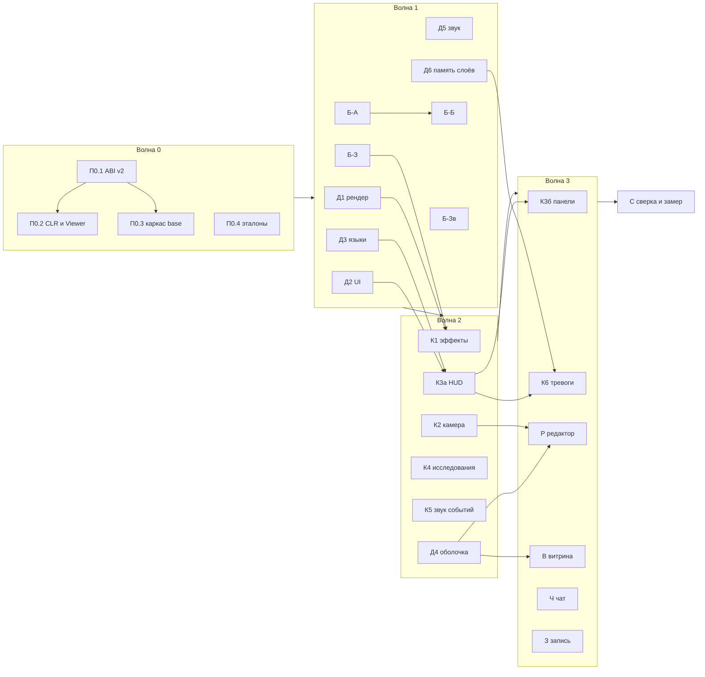

# Н6. Подача целиком

Перенос всей подачи TS-клиента в клиент .NET и клиентскую часть мода `base`. Источники: `packages/client` (около
25 тыс. строк), `packages/i18n`, `apps/native/src/record.rs`, Luau-пилот `mods/base`. В объёме: облики всех 80 видов,
эффекты, HUD, окно исследований, редактор, меню с витриной, первые шаги, тревоги, чат, звук и музыка, запись роликов.

Приёмка: клиентские тесты TS (`packages/tests`) с дословными заголовками, сверка кадров с TS (Н6.4; эталоны TS — headless Chrome со SwiftShader, решено 2026-10-19), эталоны звука.
Общий план — `docs/dotnet.md`, §6, Н6; форма — как `docs/dotnet-n5.md`.

## Н6.0. Главные решения

| # | Вопрос | Решение |
|---|---|---|
| Н6-1 | Кто рисует сущности | Движок, как сейчас (`ClientGame.Sprites`): облик по `Proto`, кадр по углу и фазе, сторона, тень, огни. Мод уточняет записью `Paint` (вариант, кадр, доля постройки, затемнение, «скрыть») и кладёт свободные спрайты (эффекты, призраки) записью `Sprite`. Смысл игры — в моде, в движке — примитивы. |
| Н6-2 | Варианты и работа зданий | Поток облика получает флаги `LookVariants` (стена — 16 вариантов, ворота — 17, дверь шахты — 8 шагов и подъём 4) и `LookWorking` (второй набор кадров «в работе», как `framesOf` в `buildingsPass.ts`). Ячейка: вариант × фазы × направления. |
| Н6-3 | Редактор **[решено, 2026-10-19]** | Оболочка — в `Kharos.Client/Shell/Editor*` (режим, право редактора, сохранение карты, вход из меню и по `/editor`), содержимое панели — в `Base.Client/Editor` (кисти, виды, месторождения, перетаскивание, призраки). Уточняет Р11: кисти и виды принадлежат `base`, а по Р4 мод может всё, что может `base`. |
| Н6-4 | Витрина меню | Сценки переезжают из `tests/.../Players/ShowcaseTests.cs` в мод: `Base.Host/Sections/Showcase` и партия `showcase` в `data/games.json`. Меню запускает её через `LocalGame` без тумана; камера-режиссёр и музыка меню — `Base.Client`; щелчок и наведение в меню синтезирует оболочка. |
| Н6-5 | Языки | Проект `src/Kharos.I18n`: словари, `t()`, множественное число, `rich` (значки между кусками). Ключи оболочки — `src/Kharos.I18n/lang/*.json`, ключи игры — `mods/base/i18n/*.json` (данные мода, Р12). Движок сливает словари всех модов. Хост шлёт ключ и аргументы, а не готовый текст. |
| Н6-6 | Тесты клиента | Клиентский мод в режиме CLR (как Н5-5) поверх сценария `Sim`. Обвязка `Viewer`: реплика игрока, ввод, запись звуковых команд, дерево UI, рисунки. Без окон и устройства звука, GPU без окна. Тот же набор — на `client.wasm` (`KHAROS_MODS=wasm`) локально. |
| Н6-7 | Команды чата модов | Объявляются в `mod.json` (`"commands": [{ "name", "args", "admin", "order" }]`); хост превращает команду в приказ мода с `ChatCall` (слова и разрешённые номера игроков), ответ — сигналом `chat.reply` автору. Так переносятся `/give`, `/spawn`, `/killunits`, `/heal`. |
| Н6-8 | `blind` у ракет | Клиент решает по видимости: `toX/toY` у `Missile` — `@private`, чужому приходят как NaN (если приходит 0 — правка в `Kharos.Protocol`). NaN — слепой полёт до удаления хостом (`missileAt` из `missiles.ts`). |

## Н6.1. Опись

Статусы: **есть**, **часть**, **заглушка**, **нет**. Пути `Art/…`, `Hud/…` — от `dotnet/mods/base/Base.Client/`.

| Что | TS | .NET сейчас | Куда | Пакет |
|---|---|---|---|---|
| Юниты (18) и турели (8), портреты | `game/units/unitArt.ts`, `portraits.ts` | есть, до байта (`Looks/golden/art.json`) | `Art/UnitArt.cs`, `UnitDraw.cs` | — |
| Месторождения (6) | `depositsPass.ts` | есть | `Art/DepositArt.cs`, `ItemLook` | — |
| Здания (48) | `buildings/buildingArt.ts` (1961 стр.), `buildingsPass.ts` | заглушка: завод есть, 47 заглушек; нет вариантов, кадров работы, «растёт снизу», выключенного | `Art/Buildings/<Вид>.cs`, `Paint` | Б-А, Б-Б, Д1 |
| Значки грузов, покрытия, уровней; кадры взрыва, дыма, молнии | `goodIcons.ts`, `portraits.ts`, `combatPass.ts`, `powerPass.ts` | нет | `Art/Icons.cs`, `Art/Effects.cs` | Б-З |
| Shot (пуля, снаряд, ракета, огонь, цепь, лазер), Blast, Burst, вспышки | `combatPass.ts` (979) | нет | `Effects/Combat.cs` | К1 |
| Ракеты, перехватчики, `blind` по зрителю | `missiles.ts` | нет | `Effects/Missiles.cs`, `MissileRules.Lift` | К1 |
| Лучи стройки, ремонта, снабжения (`Beam.links`), щиты, копание | `combatPass.ts`, `powerPass.ts` | нет | `Effects/Links.cs` | К1 |
| Трубы и партии | `flowPass.ts` | нет | `Effects/Flow.cs` | К1 |
| Молнии нехватки, полосы состояния, знаки нехватки, недостижимое | `powerPass.ts`, `statusBars.ts`, `lacks.ts` | нет | `Effects/Power.cs`, `Hud/Lacks.cs` | К1 |
| Колея | `decalsPass.ts` | есть | `Effects/Traces.cs` | — |
| Остовы, гарь, разбитые плиты, дропы | `decalsPass.ts`, `dropsPass.ts` | нет | `Effects/Wrecks.cs`, `Effects/Drops.cs` | К1 |
| Покрытие (дорога, фундамент, мост) | `pavingPass.ts` | нет | клетки слоя в Gpu (`CellLook`), `Art/Paving.cs` | Д1, Б-З |
| Земля, свет, сутки, туман | `terrain.frag`, `lightingPass.ts`, `fogPass.ts` | есть | — | — |
| Погода и осадки | `weather.frag`, `weatherAt` | есть, тестов нет | тесты | К2 |
| Тряска камеры | `shake.ts` | нет | `Camera/Shake.cs` | К2 |
| Камера: разгон, инерция, колесо к курсору, полёт | `camera.ts`, `cameraMotion.ts` | часть (`Cameras/Cameras.cs`) | `Camera/Motion.cs` | К2 |
| Выбор: рамка, двойной щелчок, группы, отметки, путь | `selectionPass.ts`, `controls.ts` | часть (`Controls/SelectControl.cs`) | `Controls/*` | К2 |
| Постановка, граница зоны, кисть покрытия, точка сбора | `placing.ts`, `cursorPass.ts` | нет | `Controls/Placing.cs`, `Effects/Cursor.cs` | К2 |
| Приказ точкой и Shift | `controls.ts` | есть (`OrderControl.cs`) | — | — |
| Мини-карта: рамка камеры, метки, переход щелчком | `minimap.ts`, `bar.ts` | часть | `Hud/Minimap.cs` | К3а |
| Верхняя полоса | `gui/hud.ts`, `game/hud.ts` (1148) | часть (кредиты) | `Hud/TopBar.cs` | К3а |
| Нижняя панель: сведения, сетка 4×3 со страницами | `gui/bar.ts`, `ui/commands.ts` (830), `unitStats.ts` | часть (завод, MCV) | `Hud/Bar.cs`, `Hud/Commands.cs` | К3а |
| Окно исследований | `gui/tech.ts`, `techOf` | нет | `Research/TechWindow.cs` | К4 |
| Космопорт: сделка, подарок; «Отдать союзнику»; кнопки заказа склада | `dealOf`/`commandsOf`, `bar.ts` | нет | `Panels/Trade.cs`, `Panels/Gift.cs` | К3б |
| Игроки и союзы, защита, поражение, «начать заново» | `gui/hud.ts`, `protectionOf` | нет: сигналы `ally`, `defeated`, `sheltered`, `player_respawned` не разбираются | `Panels/Players.cs` | К3б |
| Тревоги и уведомления | `alerts.ts` | нет (только звук отказа) | `Alerts/*` | К6 |
| Первые шаги | `firstSteps.ts` | нет | `Steps/*` | К6 |
| Чат: окно и дополнение команд | `gui/chat.ts` | нет (на хосте есть, Н4) | `Kharos.Client/Shell/Chat.cs` | Д4 |
| Команды хоста `/give`, `/spawn`, `/killunits`, `/heal` | `host.ts` | нет | `mod.json` → `Base.Host/Sections/Players` | Ч |
| Меню, новая игра с предпросмотром, подключение, слоты, настройки | `gui/screens/*`, `ui/launch.ts`, `storage.ts`, `preview.ts` | нет: Desktop сразу открывает партию | `Kharos.Client/Shell/*` | Д4 |
| Витрина меню | `gui/screens/showcase.ts`, `sim-ts/showcase.ts` | сценки — только в тестах | `Base.Host/Sections/Showcase`, `Camera/Director.cs` | В |
| Редактор, `Ghost` | `editor.ts`, `editorPanel.ts` (622), `terrain.ts` | приказы `edit.*` есть, клиента нет | `Shell/Editor*`, `Base.Client/Editor/*` | Р |
| Языки (8) | `packages/i18n` | нет | `src/Kharos.I18n`, `mods/base/i18n` | Д3 |
| Банк звуков | `synth.ts`, `worldSynth.ts`, `motorSynth.ts` | часть: 47 имён пилота; нет `artillery`, `bombFall`, `flame`, `flak`, `gate`, `shield*`, `ship*`, `coins`, `gift`, `defeat`, `chat*`, `powerOn/Off`, `cargo` и др. | `Sounds/*` | Б-Зв |
| Звуки мира и боя (события) | `worldSounds.ts` (536), `soundscape.ts` | нет (только синтез) | `Audio/WorldEvents.cs`, `Audio/Battle.cs` | К5 |
| Моторы, машины, фон, полёт | `drive.ts`, `motors.ts`, `machines.ts`, `ambience.ts`, `flight.ts` | есть или часть; тестов TS нет | тесты, доводка `MachinesAudio` | К5 |
| Музыка | `audio/music.ts` | нет (этап `Music` в SDK есть) | `Music/Music.cs` | К5 |
| Снимок кадра | — | есть (`KHAROS_SHOT`, окно невидимо) | сцена, час, часы | П0.4 |
| Запись роликов | `apps/native/src/record.rs` | нет | `apps/Kharos.Desktop/Record.cs` | З |
| Память предметных слоёв (месторождения в тумане, следы в обзоре) | sim | нет (открыто с Н5) | `Kharos.Host/Vision*`, `Engine/Layers` | Д6 |

## Н6.2. Движок и мод

**Движок** (`Kharos.Client`, `Kharos.Gpu`, `Kharos.Audio`, `Kharos.I18n`): проходы и примитивы (спрайты сущностей с
`Paint`, свободные спрайты, огни и лучи, линии с пунктиром, клетки слоёв `CellLook`, мини-карта земли и тумана); UI-ядро
(поле ввода, значки в тексте, прокрутка, модальное окно); оболочка (меню, настройки, чат, подключение, слоты, режим
редактора, снимок, запись); граф звука и шины, офлайн-рендер для тестов и записи; словари.

**Мод** (`Base.Client`): облики, эффекты, HUD, панели, окно исследований, тревоги, первые шаги, камера, управление,
звук событий, музыка, панель редактора, режиссёр витрины. На хосте (`Base.Host`) — сценки витрины и команды чата.

**ABI клиента, версия 2** (`src/Kharos.Mod.Sdk/Abi/ClientAbi.cs`, волна 0). Новые инструменты:

| № | Инструмент | Вход → выход |
|---|---|---|
| 48 | Text | ключ `str`, аргументы `n:u16 (str)×n` → `str` на языке игрока; словари всех модов |
| 49 | Prefs | ключ `str` → байты (настройка мода в `IStorage`: пройденные шаги, громкости) |
| 50 | Roster | → `(player:u32 nick:str online:u8 admin:u8)×n` из ростера протокола |
| 51 | Settings | → JSON настроек партии (`games.json` плюс карта: час, сутки, туман) и права (Editor, Admin) |

Новые записи выхода кадра:

| Запись | Формат | Назначение |
|---|---|---|
| `0x1A Field` | `id:str value:str style` | поле ввода; правки — во входе кадра |
| `0x1B Icon` | `look:i32 cell:u16 size:f32` | значок внутри текста |
| `0x23 Sprite` | `look:i32 variant:u16 frame:u16 angle:f32 x y:f32 scale alpha:f32 team:u8 layer:u8 tint:u32` | свободный спрайт облика |
| `0x24 Paint` | `entity:u32 mask:u8 [variant:u16] [frame:u16] [built:f32] [dim:f32]`, бит «скрыть» | уточнение спрайта сущности на кадр |
| `0x25 Light` | `x y spot bloom level:f32` | огонь |
| `0x26 Beam` | `x y length level cos sin near spread` | луч |
| `0x51 Prefs` | `key:str len:u32 bytes` | запись настройки мода |
| `0x52 Shell` | `action:u8 arg:str` | просьба к оболочке: в меню, открыть чат с текстом, настройки |

Прочее: поток облика — флаги `LookVariants = 64` (`variants:u16`) и `LookWorking = 128` (фазы удваиваются); манифест
(`ModAbiTypes.cs`) — `CellLooks (layer, field, looks[], connect)` для покрытия с соседством; вход кадра — `lang:str`,
`edits: n (id:str value:str)`, `shell:u8` (меню поверх партии, редактор, запись), `roster:u32` (ревизия). Проверить
инструменты 14, 16, 17 и 21 над репликой: на них стоят `Placing` и `canPlace` из `Base.Shared/Rules`.
**Дополнения v2 после волны 1** (без смены версии, старые моды пишут те же байты): инструмент 52 Look (имя → номер облика,
−1 — нет; свободные облики мода получают номера после видов, в порядке объявления); запись `0x1C FieldWith` (`id value
style mask:u8` и хвост: Digits, Password, Focus, MaxLength `u16`, Placeholder `str`); пунктир `0x27 Dashes x1 y1 x2 y2
rgba step dot` и `0x28 DashedCircle x y r rgba dashes:u16 dot`; биты стиля `ScrollEnd` (1<<24), `Modal` (1<<25),
`KeepFocus` (1<<26). Сторону союзника движок определяет сам по `Team.head`.

## Н6.3. Тесты

Обвязка `tests/Kharos.Base.Scenario/Viewer*.cs`: `sim.Viewer(player)` поднимает `ClientGame` в режиме CLR на реплике
хоста сценария — `Frame(input)`, `Sounds` (имена `Play`, `SoundAt`, `Loop`, `Voice`), `Ui` (тексты и кнопки по id),
`Draws` (записи 0x20–0x26), `Click(id)`, `Sent` (приказы). Звук и GPU не создаются (`Audio = null`); кадровые тесты —
`GpuContext.TryCreateHeadless`, без адаптера пропуск. `tools/parity.ps1` получает папки `Kharos.Client.Tests`,
`Kharos.Base.Tests/Client`, `Kharos.Base.Tests/AudioTests`, `Kharos.Audio.Tests`. Заголовок —
`[Fact(DisplayName = "<заголовок TS дословно>")]`.

Цель — 543 из 631 (сейчас 465): ещё 71 клиентский тест и 7 тестов Д6. По пакетам:

| Пакет | Куда | Тесты TS |
|---|---|---|
| П0.4 | `Kharos.Client.Tests/Looks/PixmapTests.cs` | pixmap (5) |
| Д3 | `Kharos.Client.Tests/I18n` | i18n (2) |
| Д4 | `Kharos.Client.Tests/Shell` | preview (1), storage (3) |
| Д6 | `Kharos.Host.Tests`, `Base.Tests/Sim` | depositLayer (2, снять Skip), renewal (1, снять Skip), traces (1 снять Skip + 3 новых) |
| Б-А, Б-Б | `Base.Tests/Looks` | buildings (2, снять Skip) |
| Б-Зв | `Base.Tests/AudioTests` | audio (5) |
| К1 | `Base.Tests/Client/Effects` | lacks (3) |
| К2 | `Base.Tests/Client/Camera` | camera (6), zoneOutline (1), weather (3) |
| К3а | `Base.Tests/Client/Hud` | knownReserve (1), request (1, снять Skip) |
| К3б | `Base.Tests/Client/Panels` | deal (1), ferry (3, снять Skip), gift (2, снять Skip); свои: сигналы `ally`, `defeated`, `sheltered`, `player_respawned` |
| К5 | `Base.Tests/AudioTests` | motors (5), motorsGame (1), machines (1), worldSounds (4) |
| К6 | `Base.Tests/Client/Alerts` | alerts (6), firstSteps (2) |
| Р | `Base.Tests/Client/Editor` | editor Ghost (1, снять Skip) |
| Ч | `Kharos.Host.Tests/ChatTests.cs` | chat (11; часть покрыта под другими заголовками — переименовать, дописать), ferry `/give` (1, снять Skip) |

## Н6.4. Сверка кадров

Три уровня, от точного к грубому.

1. **Облики — до байта** (продолжение Н3). `tests/Kharos.Base.Tests/Looks/dump.ts` расширяется: все 48 зданий ×
   варианты × кадры работы (`buildingsSprites`), огни, кадры эффектов (взрыв 8 × 48², клубы, молнии), значки грузов,
   портреты покрытия и уровней. Эталон — `golden/art.json`, хеш на кадр. `LookGoldenTests` сверяет `client.wasm` и CLR
   без допуска, без GPU.
2. **Проходы — с допуском.** Около 10 сцен по 640×400 описаны одинаково в TS (`dotnet/tools/golden/frames.ts`, сборка
   Vite, как у `apps/web`) и в C# (`Viewer`): четыре биома в полдень, ночь с огнями и фарами, туман, дождь, снег и
   пыль, колея и остовы, стороны и серые ничьи, стройка и выключенное, бой (кадр взрыва), панели HUD. Совпадают зерно,
   сущности, камера, час и замороженные часы. TS — headless Chrome со SwiftShader (`--use-angle=swiftshader`) через CDP,
   как `tools/smoke/browser.ts`; PNG — в `dotnet/tests/Kharos.Client.Tests/Frames/golden/`. .NET — `Renderer` без окна на
   программном адаптере (`KHAROS_GPU_ADAPTER=software`, `ForceFallbackAdapter`: WARP на Windows, lavapipe в WSL).
   Допуск: не больше 0,5 % пикселей с Δ канала > 24, средняя |Δ| ≤ 2; земля — маской и долями палитры, как в
   `TerrainFidelityTests`. Разница — в `dotnet/.cache/frames/<сцена>-{ts,net,diff}.png`.
3. **Партия целиком — на глаз.** `KHAROS_SHOT` получает `KHAROS_SHOT_SCENE` (сценка витрины), `KHAROS_SHOT_HOUR` и
   `KHAROS_CLOCK=fixed`; пары кадров с TS смотрит человек, образцы — `docs/screenshots/*.png`. Без жёстких ворот.

На macOS в CI — уровень 1 и уровень 2 с ослабленным допуском или пропуском (программного адаптера нет). Окон нет нигде:
тесты — GPU без окна, `KHAROS_SHOT` и запись — невидимое окно GLFW, звук в тестах отсутствует (`Audio = null`,
`KHAROS_AUDIO=off`), эталоны звука — офлайн (`Kharos.Audio.Tests/Offline.cs`).

## Н6.5. Волны и владение файлами

Общие файлы делаются в волне 0 одним владельцем и потом не правятся: `ClientAbi.cs`, `ModAbiTypes.cs`, SDK `Client/*`;
`ClientGame.cs` делится на partial (`ClientGame.Sprites.cs`, `.Effects.cs`, `.Ui.cs`, `.Audio.cs`); `BaseClient.cs` со
списком разделов, `<Раздел>/<Раздел>Section.cs` с `Setup` и `Frame`; профили подачи — подобъект `client` у партий в
`data/games.json` вместо зашитого `ClientProfile`. `docs/` правит координатор.

| Волна | Пакет | Владеет | Зависит от | Модель |
|---|---|---|---|---|
| 0 | П0.1 ABI клиента v2 | `ClientAbi.cs`, `ModAbiTypes.cs`, `Mod.Sdk/Client/*`, `Kharos.Client/Game/{ClientStream,ClientTools,LookStream,FrameInput,AbiStream}.cs`, деление `ClientGame`, заглушки записей и инструментов | — | Opus |
| 0 | П0.2 Клиент в CLR и `Viewer` | `Plugins/Game/ClrModule.cs` (клиентская сторона), `Kharos.Client/Game/ClientModule.cs`, `tests/Kharos.Base.Scenario/Viewer*.cs`, `tools/parity.ps1` | П0.1 | Opus |
| 0 | П0.3 Каркас `Base.Client` | `BaseClient.cs`, папки разделов с заглушками, `games.json` (`client`), `mods/base/i18n/` | П0.1 | Opus |
| 0 | П0.4 Эталоны | `Looks/dump.ts` и `golden/`, `dotnet/tools/golden/frames.ts`, `tests/Kharos.Gpu.Tests/Parity.cs`, `KHAROS_GPU_ADAPTER` в `GpuContext.cs`, `KHAROS_SHOT_*` в `DesktopOptions.cs`, `PixmapTests` | — | Sonnet |
| 1 | Д1 Рендер | `src/Kharos.Gpu/**`, `ClientGame.Sprites.cs`, `ClientGame.Effects.cs` | П0.1 | Opus |
| 1 | Д2 UI-ядро | `src/Kharos.Client/Ui/**`, `ClientGame.Ui.cs` | П0.1 | Sonnet |
| 1 | Д3 Языки | `src/Kharos.I18n/**`, ключи оболочки и игры из `packages/i18n`, инструмент 48, ключи в сообщениях хоста (`HostSession.cs`, `Protocol/Messages.cs`) | П0.1 | Sonnet |
| 1 | Д5 Звук движка | `src/Kharos.Audio/**`, `ClientGame.Audio.cs`: офлайн-рендер, WAV для записи, звуки оболочки | — | Sonnet |
| 1 | Д6 Память слоёв | `Kharos.Host/{Vision,VisionView}.cs`, `Engine/Layers/*`, `engine.traces` | — | Opus |
| 1 | Б-А Здания, часть 1 | `Art/Buildings/` от `command` до `barracks` (25), `Art/BuildingKit.cs` | П0.3, П0.4 | Sonnet |
| 1 | Б-Б Здания, часть 2 | `Art/Buildings/` от `mine` до `cannonTurret` (23): стена, ворота, трубы, турели | Б-А (`BuildingKit`) | Sonnet |
| 1 | Б-З Значки и кадры эффектов | `Art/Icons.cs`, `Art/Effects.cs`, `Art/Paving.cs` | П0.3, П0.4 | Sonnet |
| 1 | Б-Зв Банк звуков | `Sounds/*`, `AudioTests/BankGolden.cs` | П0.3 | Sonnet |
| 2 | К1 Эффекты | `Effects/*` (кроме `Traces.cs`), `Hud/Lacks.cs` | Д1, Б-З | Opus |
| 2 | К2 Камера, управление, атмосфера | `Camera/*`, `Controls/*`, `Atmosphere/*` | Д1, П0.2 | Sonnet |
| 2 | К3а HUD | `Hud/*` | Д2, Д3, Б-З | Opus |
| 2 | К4 Исследования | `Research/*` | Д2, Д3 | Sonnet |
| 2 | К5 Звук событий и музыка | `Audio/*`, `Music/*` | Б-Зв, Д5 | Sonnet |
| 2 | Д4 Оболочка | `src/Kharos.Client/Shell/**`, `apps/Kharos.Desktop/{Shell,Program}.cs` | Д2, Д3 | Opus |
| 3 | К3б Торговля, союзы, сигналы | `Panels/*` | К3а | Sonnet |
| 3 | К6 Тревоги и первые шаги | `Alerts/*`, `Steps/*` | К3а, Д6 | Sonnet |
| 3 | Р Редактор | `Shell/Editor*`, `Base.Client/Editor/*` | Д4, К2 | Opus |
| 3 | В Витрина | `Base.Host/Sections/Showcase`, `games.json` (`showcase`), `Camera/Director.cs` | Д4 | Sonnet |
| 3 | Ч Команды чата модов | `Kharos.Content` (`commands`), `Kharos.Host/ChatCommands.cs`, `Base.Host/Sections/Players/Chat*.cs` | Д3 | Sonnet |
| 3 | З Запись роликов | `apps/Kharos.Desktop/Record.cs`, `DesktopOptions.cs` | Д5 | Sonnet |
| 4 | С Сверка кадров и замер | сцены уровня 2, правки по разнице (по согласованию с владельцами), замер `kh_frame` | все | Opus |

Пишущие агенты собирают и гоняют только свои проекты и тесты (`--filter` по своей папке). Полный набор после каждой
волны гоняет один проверяющий: `build-mods.ps1`, `dotnet test` всего решения на Windows и в WSL в режимах CLR и
`KHAROS_MODS=wasm`, `tools/parity.ps1`, сверку кадров уровней 1 и 2 на программном адаптере, смоук `kharos.exe` с
`KHAROS_SHOT` (меню и партия) и `KHAROS_AUDIO=off`. CI — только macOS и финальный прогон.

## Н6.6. Риски

| Риск | Что делаем |
|---|---|
| WebGL и WebGPU расходятся: sRGB, смешивание, точность `sin` в хеше земли | Уровень 2 с допуском и маской земли; облики — до байта (уровень 1) |
| WARP рисует ночь не темнее дня (`ShowcaseTests` в Gpu) | Разобрать в Д1 первым делом; запасной путь — lavapipe в WSL |
| Цена кадра мода в wasm: HUD, эффекты, звук каждый кадр через границу | Замер в С: `kh_frame` ≤ 4 мс при 1000 видимых юнитов; тяжёлое — в примитивы движка (`Paint` пакетом, клетки слоя) |
| Объём обликов: 1961 строка, до байта | Файл на вид, общий `BuildingKit`, хеш на кадр; два пакета параллельно |
| `Paint` и `Sprite` раздувают выход кадра | Пакетная запись и предел на кадр, как `MaxParticles` |
| Граница редактора (Н6-3) | Решено: делим (Н6-3) |
| Сценки витрины переезжают в мод | Тесты Players/Showcase переводятся на партию `showcase` без смены заголовков |
| Хост шлёт русский текст | Д3 переводит сообщения на ключи; старые клиенты не поддерживаются (протокол 3) |
| Для записи нужен ffmpeg | Нет ffmpeg — последовательность PNG и WAV |
| Headless Chrome и SwiftShader у разработчика | Путь из `CHROME`, как у `tools/smoke`; эталоны в репозитории, нужны только при перегенерации |

## Н6.7. Вне Н6

- Касания и долгое касание, IME, запечённый атлас шрифтов, раскладка для телефона (`docs/screenshots/phone.png`).
- Расхождения баланса и скорость боя в wasm (открыто с Н5), `knownReserve` в хосте.
- Сетевые и устаревшие тесты без пары: `net` (19), `land` (6), `loop` (5), `local` (6), `limits` (4), `saveFile` (4),
  `serverSettings` (3) — разбор в Н7 при сверке паритета; `ecs`, `mods`, `components`, `landRust` устарели.
- Звук в роликах сверх WAV рядом с видео; запись по сети.
- Распространение, подпись, проверка версии (§4.5) — Н7.
