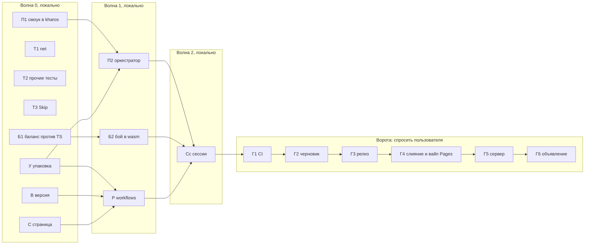

# Н7. Паритет и переключение

Довести паритет с TS и переключиться на .NET: смоук всего, баланс в допуске, игровые сессии на сервере и в одиночной
игре, распространение без подписи (win-x64, linux-x64, linux-arm64), сервер .NET в релизах, ссылки на скачивание на
странице, вайп. Общий план — `docs/dotnet.md`, §4.5 и §6 (Н7); форма — как `docs/dotnet-n6.md`.

**[решено, 2026-10-20]** Подписи кода и macOS в Н7 нет: неподписанные сборки win-x64, linux-x64, linux-arm64. Подпись,
osx, нотаризация и macOS в CI — Н7.9 «Позже», без пакетов.

**[решено, 2026-10-20]** Релизы — из `DigLik/kharos.NET` (`KharosRepo`). В WSL ставятся `mesa-vulkan-drivers`, `clang`, `zlib1g-dev`: сверка кадров, смоук с рендером и упаковка linux-x64 — локально. Волны только коммитятся; push ветки (и тем самым CI) — на воротах Г1.

**Ворота.** Шаги с пометкой **«спросить пользователя»** не выполняются без ответа пользователя в чате: релиз, слияние в
`main` (переключает Pages), вайп, замена сервера. Вся локальная работа (волны 0–2) — раньше них.

## Н7.0. Главные решения

| # | Вопрос | Решение |
|---|---|---|
| Н7-1 | Что значит «баланс в допуске» | Две сверки. **(а) Регрессия:** вывод .NET против `Balance/golden/*.json` с допуском `GoldenCompare` (доли ±5 %, время ±2 с, счёт ±1), `KHAROS_BALANCE_ALLOW=0`, в CLR и wasm. **(б) Против TS** (`Balance/golden/ts/*.json`): разделы без правила погони — economy, research, movement, nuke, `combat/table` — в тот же допуск; разделы с атакой — `combat/duel`, siege, raid — тот же победитель, время и остаток ±10 %. Каждое расхождение сверх этого — с причиной в `Balance/golden/ts/DIFF.md`; если причина — ошибка, она чинится в Н7. |
| Н7-2 | Смоук | Сценарий исполняет сам `kharos` по `KHAROS_SMOKE=<script.json>` — скрытое окно, `KHAROS_AUDIO=off`, профиль изолирован `KHAROS_HOME`. Процессами управляет `tools/Kharos.Smoke`: запускает опубликованные `kharos` и `kharos-server`, собирает отчёты. Процессы синхронизируются условиями по миру. |
| Н7-3 | Без GPU | `KHAROS_GPU=none`: окна и рендера нет, кадры по таймеру, UI и мод работают, рисование пропускается. Запасной путь; основной — настоящий адаптер (WARP на Windows, WSLg или lavapipe в Linux). |
| Н7-4 | Версии | Три номера: сборка `KharosVersion` в `Directory.Build.props` (SemVer, первая сборка .NET — `0.2.0`, подтверждается при релизе), протокол `Welcome.ProtocolVersion = 3`, сохранение `SaveFile.Version = 1`. С первого релиза KHSV 1 публичен: правка формата сохранения поднимает его версию, сервер откладывает старый файл; миграций нет, как в TS. |
| Н7-5 | Проверка версии | Сервер сверяет только протокол. Клиент при `versionOld` показывает «скачайте новую версию» с кнопкой (`BuildInfo.ReleasesUrl` через `OpenUrl`). Версия сборки — в меню рядом с протоколом; `kharos-server --version` печатает обе. Самообновления и опроса GitHub при старте нет. |
| Н7-6 | Что в сборке | Игрок и сервер получают только `base` (`mod.json`, `host.wasm`, `client.wasm`, `data/`, `schema/`, `i18n/`). `hello` — пример в репозитории, в сборки не идёт. Без `*.wasm` упаковка падает. |
| Н7-7 | Где игра и сервер | В одном релизе с тегом `v<версия>`. Имена файлов без версии, поэтому ссылки `releases/latest/download/<имя>` постоянны. Старые релизы `server-*` остаются архивом TS. |
| Н7-8 | Страница | `dotnet/site/`: статическая страница (русский и английский) с кнопками скачивания, запуском сервера и требованиями. `pages.yml` выкладывает её вместо `apps/web` — только при слиянии в `main` (ворота Г4). |
| Н7-9 | Старые сохранения | По Р6 не переносятся: сервер .NET откладывает KHRS как негодный (`UnreadableSaveIsMovedAside`); сохранения браузерной игры уходят вместе со страницей. |

## Н7.1. Открытые хвосты

| Хвост | Решение | Пакет |
|---|---|---|
| Баланс: расхождения с эталонами TS | Сверка (б) по Н7-1, `DIFF.md` с причиной на каждый пункт; ошибки чинятся (бой — Б2, остальное — Б1) | Б1, Б2 |
| Бой в wasm: мод 29 мс при цели 20, худший тик 103 мс | **Исправить.** Ворота на 10 тыс. с `KHAROS_MODS=wasm`: средний тик ≤ 35 мс, худший ≤ 50 мс, мод ≤ 22 мс. Горячее в `combat/fight` (поиск целей, урон по классам) — в пакетный инструмент движка | Б2 |
| p95 `kh_frame` в wasm 5–7 мс | **Принять:** среднее 2,9–3,6 мс в цели, p95 укладывается в кадр 16,7 мс | — |
| Сверка кадров на Linux | **Исправить:** в CI на ubuntu — `mesa-vulkan-drivers` (lavapipe), уровни 1–2; в WSL — только с разрешения пользователя | Р |
| Кадры боя, следов, HUD вне строгого допуска | **Принять с причиной:** бой .NET идёт иначе, текст Chrome толще пиксельного шрифта; потолки в тестах не должны расти | — |
| Фон-витрина меню не всегда успевает на снимок | **Исправить:** `KHAROS_SHOT` и смоук ждут первый кадр витрины с пределом | П1 |
| Устаревшие пропуски «ждёт …» (4): mining «шахта ставится только на месторождение…», terrainSpeed «солончаки…», units «чужими юнитами командовать нельзя», vision «разведчик видит дальше…» | **Снять Skip и довести** | Т3 |
| Пропуски «устарело» (4: allies, depositLayer, research, sim) | Оставить | — |
| Ссылки README на `vicimpa/kharos` при репозитории `DigLik/kharos.NET` | Владельца релизов выбирает пользователь; ссылки — из переменной сборки `KharosRepo` | В, С |

## Н7.2. Непереведённые тесты TS (80)

По `tools/parity.ps1`: 631, перенесено 543, пропущено 8, нет 80. После Н7 «нет» = 0, все пропуски — с причиной
«устарело» в `tools/parity-obsolete.json` (файл или заголовок и причина); отчёт показывает их отдельной колонкой.

| Файл TS | Нет | Решение | Куда | Пакет |
|---|---|---|---|---|
| net | 19 | **Перенести.** Около половины уже покрыто в `NetTests`, `NetPrivacyTests`, `BuildMemoryTests` под другими именами — дать заголовки TS; дописать: альфа между тиками, остановка при пропавшем соединении, срок движения `SPAN_MOST`, выстрел раньше прочего о той же сущности, тесный бюджет и догоняющее, придержанный юнит, редкая сверка притихшего, покрытие в тумане, вспышки радара, место появления под MCV | `Kharos.Host.Tests/Net*.cs` | Т1 |
| land | 6 | **Перенести**: чанки, сохранение байт в байт, правка тайла, границы. «Смена генератора не трогает сохранённый мир…» — если в .NET есть версия генератора, иначе в устаревшее с причиной | `Engine.Tests/Terrain`, `Host.Tests/LandStreamTests.cs` | Т2 |
| loop | 5 | **Перенести** на `LocalGame` и `Scheduler`: тики по накопленному времени, независимость от частоты кадров, потолок догона, порядок систем, кадр с долей тика | `Host.Tests/LocalGameTests.cs`, `Client.Tests/Game` | Т2 |
| local | 6 | **2 перенести** («локальная игра присылает сохранение…», «показательный бой идёт сам и не сохраняется»); **4 устарели** (вкладки и воркер браузера, Р8) | `Host.Tests/LocalGameTests.cs` | Т2 |
| limits | 4 | **Дать заголовки** тестам `LimitsTests`, `ServerTests` (ведро жетонов, привратник, `X-Forwarded-For`, поток сообщений) | `Kharos.Server.Tests` | Т2 |
| saveFile | 4 | **Дать заголовки** `SaveTests`, `NetTests`; дописать свои разделы вызывающего и повреждённое тело; «прежний JSON» → «не KHSV» | `Server.Tests`, `Host.Tests` | Т2 |
| serverSettings | 3 | **2 — заголовки** `SettingsTests`; **sslip.io — устарело** (`tls auto` не поддержан) | `Server.Tests/SettingsTests.cs` | Т2 |
| ecs | 21 | **Устарело**: ECS TS; мир движка покрыт в Н1 | `parity-obsolete.json` | Т2 |
| mods | 10 | **Устарело**: Luau; песочницу, сроки и перерасходы покрывают `Kharos.Plugins.Tests` (ссылки — в описи) | `parity-obsolete.json` | Т2 |
| components, landRust | 2 | **Устарело**: Rust | `parity-obsolete.json` | Т2 |

Итог: около 580 из 631 перенесено, около 51 устарело, 0 нет; числа могут сдвинуться на тест-два по решению о `land`.

## Н7.3. Смоук и игровые сессии

**Обвязка в `kharos` (П1).**
- `KHAROS_SMOKE=<script.json>`, `KHAROS_SMOKE_OUT=<report.json>`. Окно скрыто (`IsVisible = shot is null && smoke is
  null`, плюс `KHAROS_HIDDEN=1` для ручных прогонов), звук — `KHAROS_AUDIO=off`.
- `KHAROS_HOME` заменяет `%LOCALAPPDATA%\Kharos` и `~/.local/share/Kharos`: `FileStorage.ProfileDirectory`,
  `DesktopLog.FilePath`, `NetGame.CacheDirectory`, кэш Wasmtime (`KHAROS_WASM_CACHE` по умолчанию). Смоук не трогает
  настоящий профиль пользователя.
- Шаги сценария — массив `{ "do": … }`: `click <ui-id>`, `type <field> <text>`, `key <name>`; `wait <условие>
  [timeout]` с условиями `menu`, `game`, `tick>=N`, `ui <id>`, `chat <подстрока>`, `roster <ник> online`, `allied
  <ник>`, `count <вид> >= n`, `damaged <чей>`, `lost`; `order <json>` (тем же путём, что `Sent` у `Viewer`), `chat
  <текст>`; `save <слот>`, `leave`, `load <слот>`, `editor <слот>`, `connect`; `shot <png>`, `mark <имя>`, `assert
  <выражение над mark>`. Отчёт: шаги, время, тик, число сущностей. Код возврата 0 — успех, 2 — провал шага.

**Одиночная игра** (`tools/Kharos.Smoke/scenarios/single.json`):
1. Меню с фоном-витриной: снимок, фон не пуст.
2. Новая игра: `base`, фиксированное зерно, 256².
3. Развернуть MCV, построить электростанцию и завод, выпустить юнит, ехать, 60 с игры.
4. Сохранить в слот `smoke`, выйти в меню.
5. Загрузить слот, сверить тик и число сущностей с отметкой.
6. Редактор новой карты: кисть земли, здание, месторождение, сохранить и открыть как партию.
7. Отдельный запуск записи: `KHAROS_RECORD` на 90 кадров в PNG и WAV без ffmpeg; проверить число кадров и длину WAV.

**Сервер и два клиента** (`scenarios/server.json`, оркестратор):
1. Временная папка, `settings.json` со свободным портом, `admin: "smoke"`, свой `save`; запуск `kharos-server`.
2. Клиенты A и B: `KHAROS_SERVER=ws://127.0.0.1:<порт>`, `KHAROS_NAME=a|b`, у каждого свой `KHAROS_HOME`.
3. Чат: A ждёт `roster b online`, пишет «привет», B ждёт его.
4. Бой: A через `/admin` делает `/spawn` у базы B и приказ атаки, оба ждут `damaged`.
5. Союз: `/ally b` и `/ally a`, оба ждут `allied`, затем 5 с без нового урона.
6. Переподключение: оркестратор убивает B и поднимает с тем же `KHAROS_HOME`; у B прежние юниты, призраки, разведанное.
7. Сохранение и перезапуск: `stop` в stdin сервера, выход с кодом 0, файл сохранения на месте; сервер снова, клиенты
   `connect`, сущности те же, тик идёт дальше.

**Варианты:** Windows (сервер `win-x64` и опубликованный `kharos.exe`); WSL (всё linux-x64); **смешанный** — сервер в WSL,
клиенты на Windows через localhost WSL2 (земля между ОС, Р4); **нагрузка** — `Kharos.Smoke --soak 15m --bots 8`, боты —
клиенты протокола без GPU (`GameConnector` и реплика) ездят и воюют. Ворота: нет обрывов, худший тик ≤ 50 мс, память
сервера не растёт после 5-й минуты.

**Сессии вручную.** После смоука пользователь может сам поиграть (одиночная и свой сервер) — это ворота «спросить
пользователя», не тест. Агенты видимых окон не открывают.

## Н7.4. Распространение

| Файл релиза | Что | Сборщик |
|---|---|---|
| `kharos-win-x64.zip` | `kharos.exe` (NativeAOT), `wgpu_native.dll`, `soft_oal.dll`, `glfw3.dll`, `wasmtime.dll`, `mods/base`, `LICENSES/`, `README.txt` | windows-latest |
| `kharos-linux-x64.tar.gz` | `kharos`, `libwgpu_native.so`, `libopenal.so`, `libglfw.so.3`, `libwasmtime.so`, то же прочее, `kharos.desktop`, `kharos.png` | ubuntu-22.04 (glibc 2.35) |
| `kharos-linux-arm64.tar.gz` | то же | ubuntu-22.04-arm |
| `kharos-server-linux-x64.tar.gz`, `-arm64` | `kharos-server`, `libwasmtime.so`, `mods/base`, `LICENSES/`, `README.txt` | те же |
| `SHA256SUMS.txt` | суммы всех файлов | release |

Нативные библиотеки для всех трёх RID уже в пакетах (Silk.NET.WebGPU.Native.WGPU, OpenAL.Soft.Native,
Ultz.Native.GLFW, Wasmtime). Внутри архива — папка `kharos-<версия>-<rid>/`; tar.gz сохраняет бит исполнения. AppImage,
deb, MSI — позже.

**Моды.** `tools/build-mods.ps1` один раз на ubuntu-latest, артефакт `mods-base` скачивают все задания упаковки — `.wasm`
у всех RID один и тот же. Локально — тот же скрипт.

**Упаковка.** `dotnet/tools/package.ps1 -Rid <rid> -Kind desktop|server -Version <v> -Out <dir>`: `dotnet publish -c
Release -r <rid> -p:KharosVersion=<v> -p:KharosShipMods=base`; проверка состава (обязательные `.so`, `.dll`, `.wasm`; нет
`hello` и `.pdb`); лицензии из `dotnet/licenses/` (OpenAL Soft LGPL — только динамическая связь, Р9; wgpu MIT/Apache,
GLFW zlib, Wasmtime Apache-2.0, Ark Pixel и Unifont OFL, .NET, MemoryPack, Silk.NET MIT); `README.txt` на двух языках;
архив. Локально: win-x64 на Windows, linux-x64 в WSL (для NativeAOT нужны `clang` и `zlib1g-dev`); linux-arm64 — только
в CI.

**Проекты.** `Kharos.Desktop.csproj`: на публикации убрать `hello` из `ModFile` (`Condition="'$(_IsPublishing)'=='true'"`),
`ApplicationIcon` `kharos.ico` (из `apps/web/public/favicon.png`). `Kharos.Server.csproj` уже берёт только `base`.

**Версия (Н7-4, Н7-5).** `Directory.Build.props`: `KharosVersion` (по умолчанию `0.2.0-dev`), `Version`,
`InformationalVersion=$(KharosVersion)+<sha>`, `KharosRepo`. `src/Kharos.Protocol/BuildInfo.cs`: `Version`, `Commit`,
`ReleasesUrl` из атрибутов сборки. Меню: «версия X · протокол 3». Ключи `versionOld`, `versionNew` во всех 8
`Kharos.I18n/lang/*.json` — без «обновите страницу», с кнопкой `menu.download`. Сервер печатает версию при старте и по
`--version`. Тесты: формат версии, кнопка при `versionOld`.

**Без подписи.** Windows SmartScreen покажет «Неизвестный издатель». Страница и `README.txt` объясняют «Подробнее →
Выполнить в любом случае» и проверку суммы по `SHA256SUMS.txt`; на Linux нужны Vulkan (`mesa-vulkan-drivers` или
драйвер), X11 или XWayland, `libasound2` или PulseAudio.

**Релизный workflow** `.github/workflows/release.yml` (Р): `workflow_dispatch` с входами `version` и `publish:
false|true`, плюс push тега `v*`; на `main` сам не срабатывает. Задания: `mods` (сборка на ubuntu, артефакт); `test`
(`dotnet test` на ubuntu и windows через `workflow_call` из `dotnet.yml`); `desktop` (матрица 3 RID: `package.ps1`, смоук
пакета — WARP на Windows, `xvfb-run` и lavapipe на Linux, при неудаче `KHAROS_GPU=none`); `server` (2 RID: пакет и смоук с
ботами 2 мин); `release` (`softprops/action-gh-release@v2`, `draft: true`, тег `v<версия>`, название «Kharos <версия>
(протокол 3, сохранение 1)», файлы и `SHA256SUMS.txt`, `make_latest` — только при `publish: true`). Старые релизы
`server-*` не удаляет.

**`dotnet.yml`:** убрать `macos-latest` (Н7.9); на ubuntu-latest — `mesa-vulkan-drivers` и сверка кадров уровня 2 с
`KHAROS_GPU_ADAPTER=software`; задание `package` для linux-x64 со смоуком пакета. **`server.yml`** удаляется в ветке:
до слияния ни на что не влияет, после — TS-релизы прекращаются.

**Страница** `dotnet/site/` (С): `index.html`, `style.css`, шрифт Ark Pixel из `apps/web/public/fonts`, `favicon.png`.
Кнопки скачивания по ОС (`navigator.userAgentData` или `userAgent`) и список всех файлов
`https://github.com/<KharosRepo>/releases/latest/download/<имя>`; блок «Свой сервер» (`curl`, `tar`, `PORT=8787
./kharos-server`); требования, оговорка о неподписанных сборках, ссылка на исходники; русский и английский по якорю.
Новый `pages.yml`: без Bun, копирование `dotnet/site` в `gh-pages` тем же `crazy-max/ghaction-github-pages@v4`; владелец
репозитория в ссылках — из `${{ github.repository }}`.

## Н7.5. Переключение и вайп

**Переключение:** ветка `migrate-to-dotnet` вливается в `main`; Pages показывает страницу скачивания вместо TS-игры;
последний релиз — .NET, сервер берут оттуда; TS-релизы больше не выходят; публичный сервер пользователя, если есть,
переходит на .NET с новым миром. Код TS в репозитории — до Н8.

Шаги (Г — ворота, перед каждым **спросить пользователя**):

| Шаг | Что | Проверка | Откат |
|---|---|---|---|
| Г1 | Финальный CI: `dotnet.yml` на ubuntu x64, ubuntu arm и windows | всё зелёное | — |
| Г2 | `release.yml` с `publish: false` — черновик `v0.2.0` | пользователь скачивает и смотрит архивы, `SHA256SUMS` | удалить черновик |
| Г3 | Опубликовать релиз (`make_latest`) | ссылки `latest/download/*` отдают файлы | снять «latest», вернуть на `server-80` |
| Г4 | Тег `ts-final` на нынешнем `main`, PR и слияние `migrate-to-dotnet` → `main` (вайп страницы) | `pages.yml` выложил `dotnet/site`, `server.yml` не запускался | `git revert` слияния или ручной запуск старого `pages.yml` на `ts-final` |
| Г5 | Сервер пользователя: `stop` у TS, архив `save.kharos` (KHRS) и `settings.json`, распаковать `kharos-server-linux-<arch>.tar.gz`; ключи `settings.json` те же, `tls.mode: auto` → `files` или `off` (в заметки); запуск с новым миром | смоук-клиент с Windows подключается | остановить .NET, вернуть бинарник `server-80` и архивный KHRS |
| Г6 | Объявление игрокам (делает пользователь): старые сохранения не переносятся, игра теперь устанавливается | — | — |

Г4 — точка невозврата для игроков (браузерные сохранения пропадают). До Г4 обе линии живут рядом, как требует Р6.

## Н7.6. Волны и владение файлами

`docs/` правит координатор. Пишущие агенты собирают и гоняют только свои проекты с `--filter` по своей папке.

| Волна | Пакет | Владеет | Зависит от | Модель |
|---|---|---|---|---|
| 0 | П1 Смоук в `kharos` | `apps/Kharos.Desktop/{Smoke*,DesktopOptions,Shell,NetGame}.cs`, `FileStorage.ProfileDirectory`, `SharedWasm` (кэш по `KHAROS_HOME`), `KHAROS_GPU=none`, ожидание витрины в снимке, `Desktop.Tests/SmokeScriptTests.cs` | — | Opus |
| 0 | Т1 Тесты net | `Kharos.Host.Tests/Net*.cs`, `BuildMemoryTests.cs` | — | Sonnet |
| 0 | Т2 Прочие тесты и опись | `Kharos.Server.Tests/*`, `Engine.Tests/Terrain`, `Host.Tests/{LandStream,LocalGame}Tests.cs`, `tools/parity.ps1`, `tools/parity-obsolete.json` | — | Sonnet |
| 0 | Т3 Устаревшие Skip | 4 теста в `Base.Tests/Sim/{Mining,Movement,Vision}`; правки `Base.Host` — минимальные, с отчётом | — | Sonnet |
| 0 | Б1 Баланс против TS | `Base.Tests/Balance/{BalanceVsTsTests.cs,golden/ts/DIFF.md}`, `GoldenCompare.cs`; исправления вне боя в `Base.Host/Sections/*` (кроме Combat) | — | Opus |
| 0 | В Версия | `Directory.Build.props`, `Kharos.Protocol/BuildInfo.cs`, `Shell/Menu.cs` (версия, кнопка), `Kharos.I18n/lang/*.json` (versionOld, versionNew, menu.download), `Kharos.Server/Program.cs` (`--version`), тесты | — | Sonnet |
| 0 | У Упаковка | `dotnet/tools/package.ps1`, `dotnet/licenses/**`, `dotnet/dist/README.txt`, `kharos.ico`, `kharos.desktop`, publish-часть `Kharos.Desktop.csproj` и `Kharos.Server.csproj` | — | Sonnet |
| 0 | С Страница | `dotnet/site/**` | имена файлов Н7.4 | Sonnet |
| 1 | П2 Оркестратор | `dotnet/tools/Kharos.Smoke/**` (процессы, сценарии single, server, mixed, боты, `--soak`), `tools/smoke.ps1` | П1, У | Opus |
| 1 | Б2 Бой в wasm | `Base.Host/Sections/Combat/**`, пакетный инструмент в `Engine/Tools` и `Mod.Sdk` (дополнение ABI без смены версии), замер в `tools/Kharos.Balance` | Б1 | Opus |
| 1 | Р Workflows | `.github/workflows/{release,dotnet,pages}.yml`, удаление `server.yml` | У, В, С | Sonnet |
| 2 | Сс Сессии | прогоны смоука (single, server, mixed, soak) на Windows и в WSL, исправления по найденному | П2, Б2, Р | Opus |
| 3 | Г1–Г6 | ворота Н7.5, **спросить пользователя** перед каждым | всё | — |

**Ход волн.**
- **Волна 0 — сделано** (коммит 9c93208): П1, Т1–Т3, Б1, В, У, С; Windows и Linux, CLR и wasm — зелёные.
- **Волна 1 — сделано** (коммит 6f13138): П2, Б2, Р; Windows, CLR и wasm — зелёные; смоук single и server на пакетах
  win-x64 прошёл. Ворота Б2 по худшему тику (≤ 50 мс) тогда не взяты: 51,9–53,1 мс на тике 160, где сходились проход
  `defense/supply`, урон и приказы харнесса.
- **Волна 2 — сделано на Windows** (Сс):
  - `/reveal` разведывает карту игроку слоем «разведано» чанками (`LayerSet.Fill`), а не потайловой записью: на карте
    1024² вызов стоил 290 мс тика, теперь ~9 мс (первый) и < 1 мс (повтор). Как в host.ts (`vision.explore`), он
    открывает туман до «разведано», но не зажигает видимое: чужие юниты вне обзора по-прежнему не приходят клиенту.
    Тест `VisionTests` «/reveal: вся карта разведана чанками слоя…».
  - Чат чаще `ChatGap` (0,5 с) хост выбрасывает молча — и строку, и команду; так же CHAT_GAP в host.ts, ответа нет и в
    TS. Клиенты и боты держат паузу сами (`EditorShell.ChatGap`, очередь чата ботов `Kharos.Smoke`); описано у
    `HostSessionOptions.ChatGap`.
  - `defense/supply` в wasm: сети игрока, в кругах которых стоит юнит, ищутся по массиву кругов прохода с рамкой (было
    — перебор сотен сетей через `IReadOnlyList` на каждого юнита с неполным магазином), рабочие наборы прохода — поля
    системы, без выделений на проход. Итог тот же: баланс `all` в wasm совпадает с `golden/*.json` до байта, кроме
    времени тика в таблице нагрузки movement. CombatBench (10 тыс., `KHAROS_BENCH_ARMY=1400000`, Release, wasm, 3
    прогона): supply в среднем 0,67 → 0,31 мс, пик 9,9 мс → ниже 5 мс; худший тик 51,8–53,9 → 43,7–47,1 мс (ворота ≤ 50
    взяты), среднее 23,8–24,0 мс.
  - Смоук на свежих пакетах win-x64: single (51 шаг, запись 90 кадров) и server (22 шага: чат, бой, союз,
    переподключение, stop и перезапуск) прошли; soak 15 мин с 8 ботами прошёл: обрывов 0, приказов 3565, /spawn 50,
    тик среднее 2,08 мс, худший 28,4 мс, память процесса после 5-й минуты 250 → 247 МБ (−1,1 %). Найдено и исправлено:
    `Kharos.Smoke --out` с папкой прошлого прогона подхватывал его `server/save.kharos` и профили `home-*` (сервер
    грузил старый мир) — теперь непустая `--out` получает подпапку прогона.
  - **Не проверялось (решение пользователя):** всё в WSL и на Linux — `dotnet test` в WSL, упаковка linux-x64, смоук
    mixed и смоук в WSL. Полный `dotnet test` решения не гонялся: только затронутые проекты (Engine, Host, Base — оборона
    и армия, CLR и wasm).

**Проверяющий после каждой волны (один, локально):** `build-mods.ps1`; `dotnet test` всего решения на Windows и в WSL,
CLR и `KHAROS_MODS=wasm`; `tools/parity.ps1` («нет» = 0 после волны 0); `BalanceTests` и `BalanceVsTsTests` (`-explicit
only`), CLR и wasm; замер `Kharos.Balance` на 10 тыс. в wasm (ворота Б2 после волны 1); сверка кадров уровней 1–2 на
WARP; `package.ps1` (win-x64 на Windows, linux-x64 в WSL); `tools/smoke.ps1 single|server` на опубликованных пакетах
(после волны 1), mixed и soak 15 мин (волна 2). Везде `KHAROS_AUDIO=off` и скрытые окна. CI — только Г1 и Г2.

## Н7.7. Риски

| Риск | Что делаем |
|---|---|
| NativeAOT `kharos` на Linux ещё не запускался | У пакует linux-x64 в WSL в волне 0; смоук на пакете — первым делом в волне 1 |
| glibc: бинарник со сборщика 24.04 не пойдёт на старых дистрибутивах | Сборка на ubuntu-22.04 и 22.04-arm; минимум glibc 2.35 — на странице |
| GLFW — X11, на чистом Wayland нужен XWayland | В требованиях; WSLg проверить на смоуке |
| Нет адаптера GPU в WSL или CI | lavapipe в CI, в WSL — с разрешения пользователя; запасной путь `KHAROS_GPU=none` |
| Неподписанный exe: SmartScreen, ложные срабатывания антивирусов на NativeAOT | Текст на странице, `SHA256SUMS`; подпись — Н7.9 |
| Wasmtime и нативные библиотеки не находятся рядом с AOT-бинарником | Проверка состава в `package.ps1`, смоук по распакованному архиву |
| Флаки смоука: тайминги, порты, два процесса | Условия вместо пауз, свободный порт от ОС, сроки на шаг |
| Б2 сдвигает исход боя, эталоны `Balance/golden` меняются | Б2 обновляет `golden/*.json` вместе с `DIFF.md`, проверяющий смотрит разницу |
| .NET 11 — RC (выпуск в ноябре 2026) | Первый релиз на RC — в заметках; переход на GA — отдельный коммит без смены протокола |
| Ссылки `latest/download` на чужой репозиторий | `KharosRepo` задаётся один раз, решение пользователя |
| Г4 необратим для игроков | Тег `ts-final`, архив KHRS у пользователя, откат Pages и сервера по Н7.5 |
| Старые ссылки README на голый `kharos-server-linux-x64` | Новые имена — `.tar.gz`; README переписывается в Г4 и окончательно в Н8 |

## Н7.8. В Н8

- Удаление `packages/`, `apps/web`, `apps/server`, `apps/client`, `apps/native`, `crates/`, Luau, Cargo, Bun,
  `package.json`, `bun.lock`, `tools/*.ts`, `tools/smoke/*`, `tools/harness`.
- `tools/parity.ps1` и `parity-obsolete.json`: последний отчёт — в `docs/`, скрипт удаляется. `dotnet/tools/golden/*.ts`
  удаляются, эталоны (`golden/ts`, кадры TS) остаются файлами.
- README и `docs/` (engine, content, client, overview) — под .NET или пометка «заменено».
- Возможно, `dotnet/` переезжает в корень; пути в workflows, `package.ps1` и странице — тогда же.
- Удаление старых релизов `server-*` — **спросить пользователя**.

## Н7.9. Позже (вне Н7, без пакетов)

- Подпись Windows: Authenticode (OV или EV, либо Azure Trusted Signing), секреты CI, `signtool` в `release.yml`.
- macOS: osx-arm64 и osx-x64, `.app` и dmg, Developer ID, нотаризация `notarytool`, секреты Apple, macOS в `dotnet.yml`.
- AppImage, deb, установщик Windows, win-arm64.
- Обновление из клиента и опрос новой версии при старте.
- `tls.mode: auto`; p95 `kh_frame` в wasm; касания, IME, запечённый атлас шрифтов.
