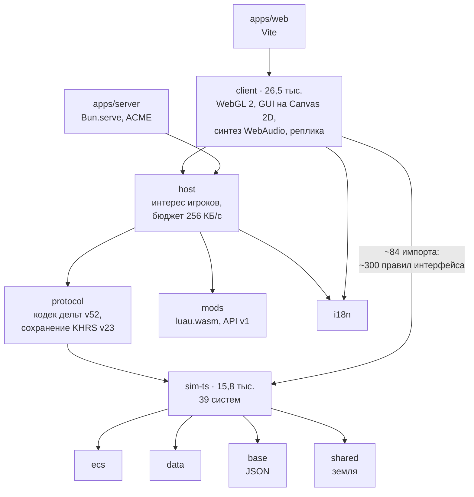
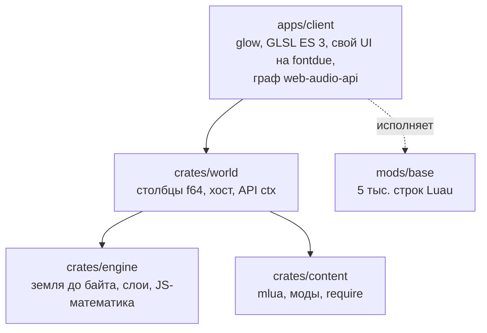
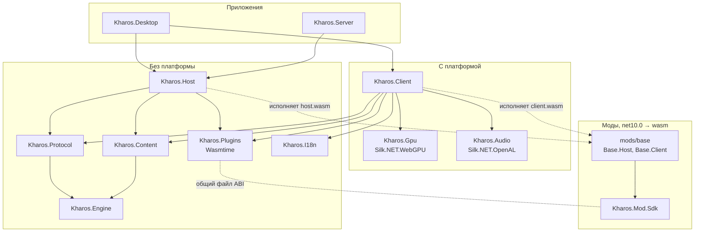

# Переход на .NET

Вся игра — движок, сервер, клиент и наша логика — переезжает на C#. Клиент — только для десктопа, на Silk.NET (WebGPU,
OpenAL Soft, Windowing, Input). Браузер не поддерживается. Моды — на C#, собранные в wasm, через систему плагинов
UserPluginSystem. Здесь — карта нынешнего кода, принятые решения, устройство решения на .NET, порядок работ и риски.

Этот документ заменяет направление Rust и Luau: `docs/engine.md` (§3–§9), `docs/content.md` (§4а, §6, К4–К7),
`docs/client.md`. Из них по-прежнему верно, **что** делает игра и где граница движка и контента. **На чём** это
написано, решает этот документ.

## 1. Решения

Решения приняты в разговоре 2026-10-18.

| # | Вопрос | Решение |
|---|---|---|
| Р1 | Что переносим | **[решено, 2026-10-18]** Всё на C#. Luau уходит совсем, вместе с ним `mods/base` на Luau и `crates/content`. |
| Р2 | Где исполняются моды | **[решено, 2026-10-18]** На хосте и на клиенте. Хост — правила. Клиент — подача, мир доступен только на чтение, менять его можно только приказом. Код клиентских модов приходит с сервера и работает в той же песочнице Wasmtime, что на хосте. |
| Р3 | Где живёт состояние мода | **[решено, 2026-10-18]** В мире. Мод объявляет компоненты и `storage`, движок держит их столбцами, сохраняет и шлёт по сети. Система мода — чистая функция: столбцы на вход, команды на выход. Экземпляр wasm можно выбросить в любой момент, пул в системе плагинов остаётся. |
| Р4 | Наша логика | **[решено, 2026-10-18]** `base` — такой же wasm-мод, как чужие. Привилегий у него нет: всё, что может base, может и мод. Движок даёт только инструменты (§4.1). |
| Р5 | Сборка мода | **[решено, 2026-10-18]** NativeAOT-LLVM, ядровой модуль wasm (не компонент). Экспорты через `UnmanagedCallersOnly`, импорты WASI заглушает хост. Один и тот же `.wasm` работает на хосте и на клиенте на любой ОС. |
| Р6 | Переезд | **[решено, 2026-10-18]** Рядом, затем вайп. TS-игра живёт и выкладывается как есть, служит эталоном поведения: тесты, `tools/harness`, `bun run balance`. .NET строится в `dotnet/` со своим протоколом и сохранением. При паритете — переключение, старые сохранения не переносятся. После — TS, Rust и Luau удаляются. |
| Р7 | Платформы | **[решено, 2026-10-18]** Клиент — Windows, Linux, macOS (x64 и arm64), NativeAOT. Сервер — Linux x64 и arm64. Нативные iOS и Android — вне плана, но архитектура их не закрывает. |
| Р8 | Браузер | **[решено, 2026-10-18]** Не поддерживается. Нет Blazor, браузерного бэкенда плагинов, хоста в воркере, второй реализации звука. После переключения игра больше не открывается по ссылке, её устанавливают. Телефоны и планшеты теряют доступ до нативных iOS и Android. До переключения TS-версия на GitHub Pages работает как сейчас. |
| Р9 | Звук | **[решено, 2026-10-18]** API графа в терминах Web Audio (на нём написан весь нынешний звук) и одна реализация: свой DSP на C# в аудиопотоке, вывод потоковыми буферами в OpenAL Soft. Сэмплы синтезирует C#. |
| Р10 | Хост одиночной игры | **[решено, 2026-10-18]** В процессе клиента, в своём потоке. С клиентом говорит тем же протоколом, что сервер, через транспорт в памяти. Клиент всегда реплика. |
| Р11 | Подача | **[решено, 2026-10-18]** Всё в `base`, кроме оболочки. Облики видов, звуки, HUD, камера, управление, эффекты, атмосфера, музыка — клиентская часть мода. В клиенте остаются меню, настройки, чат, подключение, сохранения и редактор. |
| Р12 | Данные видов | **[решено, 2026-10-18]** JSON рядом с `.wasm`. Мод — папка: манифест, `data/*.json`, `host.wasm`, `client.wasm`. Данные читает движок без запуска кода. Отсюда патчи модов поверх модов, баланс без пересборки и данные для клиента и каталога. Нынешние `packages/base/data/*.json` переезжают как есть. |
| Р13 | Первая веха | **[решено, 2026-10-18]** Срез на десктопе (§6, Н3). Повторяет Rust-пилот К4 на Windows, Linux и macOS. Так все главные риски проверяются до того, как пишутся механики. |
| Р14 | Система плагинов | **[решено, 2026-10-18]** Код UserPluginSystem копируется в `dotnet/src/Kharos.Plugins` и дальше развивается там, под игру. |

### Решено без обсуждения, технические

- **.NET 11, C# последней версии.** UserPluginSystem уже на `net11.0` (RC1), выпуск — ноябрь 2026.
- **Рендер — прямо на Silk.NET.WebGPU** (wgpu-native: Vulkan, Metal, DX12). Слой проходов и ресурсов поверх API,
  без промежуточного потока команд. Шейдеры — WGSL.
- **Детерминизм земли.** Клиент строит землю по зерну сам, а клиент и сервер — разные ОС: `Math.Sin` и `Math.Pow` в
  .NET берутся из библиотеки C платформы и могут разойтись в последнем знаке. Поэтому генератор их не вызывает, только
  свою `DetMath`: целочисленный хеш (как `Math.imul` в TS), свои приближения на `double` с фиксированным порядком
  операций. В приветствии хост шлёт сумму окна земли; при расхождении клиент просит землю байтами (кадр `LAND` есть
  и сейчас). Симуляцию считает только хост, так что ей кроссплатформенный детерминизм не нужен.
- **Сервер** — ASP.NET Core (Kestrel, WebSocket со сжатием permessage-deflate), NativeAOT, один бинарник под
  linux-x64 и linux-arm64. Ключи `settings.json` те же, что сейчас (`apps/server/settings.ts`).
- **TLS.** `wss://` и выпуск сертификата Let's Encrypt (`tls.mode: auto`) нужны были потому, что страница с GitHub
  Pages открыта по https. Десктопному клиенту это не нужно. К паритету: `tls.mode` — `off` (по умолчанию) и `files`
  (свой сертификат, Kestrel меняет его без перезапуска порта). `auto` (Certes, HTTP-01) — позже, если серверам без
  домена понадобится шифрование.
- **Шрифты.** Ark Pixel 10/12 и подмножество Unifont запекаются в растровый атлас при сборке (продолжение
  `tools/fonts.py`). Растеризатора шрифтов во время работы нет. Ввод текста — события символов Silk.NET Input; IME с
  составлением (китайский, японский) — вне паритета.
- **Сжатие** — `deflate-raw` из `System.IO.Compression`.
- **Хранилище** — файлы в каталоге данных пользователя: сохранения, настройки, пароли серверов.
- **Тесты** — xUnit. Сценарные тесты переносятся из `packages/tests`, числа сверяются с TS-эталоном с допуском,
  а не до бита.

## 2. Карта нынешнего кода и его судьба

Две линии игры живут в репозитории одновременно.

**TS — играбельная игра** (около 44 тыс. строк): все механики, сеть, сервер.

Стрелка — «зависит от».

**Rust и Luau — целевая архитектура, пилот** (К4 из `docs/content.md`): один юнит, одно здание, производство, приказ
ехать. Ни сети, ни боя, ни стройки.

| Часть | Что с ней | Откуда берём при переносе |
|---|---|---|
| `packages/sim-ts` | эталон механик до паритета, потом удаляется | правила 39 систем → системы мода `base` |
| `packages/tests`, `tools/harness`, `tools/balance.ts` | эталон поведения | сценарии → xUnit, числа баланса → сверка |
| `packages/base/data/*.json` | переезжают в `dotnet/mods/base/data` | как есть, схема — C#-типы SDK |
| `packages/i18n/*.json` (8 языков) | переезжают | как есть, ключи — генератором кода |
| `packages/shared/terrain.ts`, `crates/engine/terrain.rs` | эталон земли | генератор → `Kharos.Engine`, сверка до байта |
| `crates/engine/layers.rs` | переносится | слои мира и игрока, формат изменений |
| `crates/sim` (`path`, `walk`, `movement`, `vision`, `recall`, `occupancy`, `zones`, `traces`) | переносятся | инструменты движка |
| `packages/host/host.ts` | переносится | интерес игроков, бюджет отправки, чат, пределы |
| `packages/protocol` | заменяется | идеи кодека (квантование, варинты); формат новый |
| `crates/world` (`host.rs`, `schema.rs`) | переносится | мир по схеме модов, порядок систем, `ctx` |
| `apps/client` (`render.rs`, `gui.rs`, `audio.rs`, `atlas.rs`, `script.rs`, `shell.rs`) | переносится | проходы рендера, UI, граф звука, атлас, клиентский API, окно и ввод |
| `packages/client` (`unitArt`, `buildingArt`, `audio/*`, `gui/*`, GLSL) | эталон подачи | облики → `base` (сверка кадров), DSP, шейдеры → WGSL |
| `mods/base` (Luau) | эталон для подачи пилота | `lib/units.luau`, `lib/dsp.luau`, `ui/hud.luau` → C# |
| `apps/web`, сборка на GitHub Pages | работают до переключения, потом удаляются | — |
| `crates/sim-wasm`, `packages/sim-rust`, `tools/compare.ts` | удаляются | переходная сверка TS↔Rust |
| `crates/content`, `crates/content-bench`, `packages/mods` | удаляются | Luau |
| `apps/native` (V8, Skia) | удаляется | `record.rs` — образец записи роликов |

## 3. Решение на .NET

Всё лежит в `dotnet/`: решение `Kharos.slnx`, `Directory.Build.props`, `Directory.Packages.props`, `global.json`.

| Путь | Что внутри |
|---|---|
| `src/Kharos.Engine` | Без платформы: мир столбцами по схеме модов, порядок систем, буфер команд, события; земля и `DetMath`; слои; инструменты — пути, поля потоков, ход, столкновения, поиск в радиусе и по лучу, обзор и память, сети-графы, следы, занятость |
| `src/Kharos.Plugins` | Копия UserPluginSystem: абстракции, Wasmtime, ABI игры |
| `src/Kharos.Content` | Загрузка модов: манифест, порядок по `requires`, `data/*.json`, патчи, сумма для сверки |
| `src/Kharos.Protocol` | Сообщения, двоичный кодек дельт по схеме, формат сохранения |
| `src/Kharos.Host` | Хост: тик, игроки, приказы, интерес и бюджет отправки, чат и команды, пределы |
| `src/Kharos.Client` | Реплика, кадр, камера, атлас обликов, UI-ядро, клиентский API модов; оболочка — меню, настройки, чат, подключение, сохранения, редактор |
| `src/Kharos.Gpu` | Проходы рендера и WGSL поверх Silk.NET.WebGPU |
| `src/Kharos.Audio` | API графа, DSP на C#, вывод через Silk.NET.OpenAL (OpenAL Soft) |
| `src/Kharos.I18n` | Словари и `t()`, генератор ключей |
| `src/Kharos.Mod.Sdk` | Для мододела: API хоста и клиента на C#, экспорты ABI, сборка NativeAOT-LLVM |
| `apps/Kharos.Desktop` | Silk.NET Windowing и Input, NativeAOT; хост одиночной игры в процессе, в своём потоке |
| `apps/Kharos.Server` | ASP.NET Core, WebSocket на Kestrel, `settings.json` |
| `mods/base` | `mod.json`, `data/*.json`; `Base.Host` — системы, события, приказы → `host.wasm`; `Base.Client` — облики, звуки, HUD, камера, управление, эффекты, атмосфера, музыка → `client.wasm` |
| `tests` | `Kharos.Engine.Tests`, `Kharos.Plugins.Tests`, сценарии base, эталоны кадров и звука |
| `tools` | Balance, Bench, Smoke, FontBake, бенчмарки плагинов, `wasi-sdk`, `build-mods` |

Зависимости, стрелка — «зависит от»:

Правила:

- `Kharos.Engine`, `Content`, `Protocol`, `Host` — без платформы: ни Silk.NET, ни ASP.NET. Проверяется сборкой: у этих
  проектов нет ссылок на платформенные пакеты.
- Клиент не знает хоста. Одиночная игра — это клиент плюс хост через транспорт в памяти, собирает их `Kharos.Desktop`.
- Клиент получает окно, ввод и хранилище интерфейсами `IInput`, `IStorage`, `ITransport`: так оболочку и HUD можно
  гонять в тестах без окна.

## 4. Устройство

### 4.1. Граница движка и мода

Граница та же, что в `docs/content.md` §3: движок — мир столбцами, земля и слои, движение (пути, поля потоков,
столкновения), пакетный поиск, обзор, сети-графы, снаряды, сеть и сохранения, клиент. Всё остальное — мод.

Инструменты движка работают пакетами. На вход — список сущностей или точек, на выход — столбец. Что считается над
тысячами сущностей каждый тик, должно быть инструментом, иначе тормозит: теперь каждый тик стоит ещё и копирования через
границу wasm.

### 4.2. ABI мода

Сейчас у UserPluginSystem одна точка входа: `process_buffer(in, inLen, out, outMax)`. Для игры её мало. Экспорты мода
(генерирует `Kharos.Mod.Sdk`):

- `kh_alloc(size)` — память под столбцы и аргументы в линейной памяти мода.
- `kh_load(ptr, len)` — данные мода и схема, раз при создании экземпляра.
- `kh_system(id, n)` — система над `n` сущностями. Движок перед вызовом пишет нужные столбцы в память мода. После
  вызова забирает изменённые столбцы и буфер команд (создание, удаление, компоненты, события, сигналы клиентам).
- `kh_event(id, ptr, len)`, `kh_command(id, player, ptr, len)` — события и приказы игроков.
- Клиентские: `kh_look(kind, canvas)` — облик в атлас при загрузке; `kh_frame(...)` — UI, звук и эффекты за кадр.

Структурированные данные идут через MemoryPack, столбцы — сырыми `f64`/`f32`/`i32` без сериализации. Wasmtime даёт
движку прямой `Span` на память мода, так что столбцы копируются одним `CopyTo`. Импорты хоста — белый список
(`HostCapabilityRegistry`): инструменты движка, `random` из зерна мира, журнал. Часов у игровых модов нет
(`host_get_timestamp` убирается): так у модов нет недетерминизма.

Пределы — одни на хосте и на клиенте: прерывание по эпохам Wasmtime (уже есть в UserPluginSystem), после трёх
перерасходов мод выключается. Память — 64–256 МБ на экземпляр: рантайм NativeAOT-LLVM занимает мегабайты, нынешние
2 страницы по 64 КБ не подходят.

### 4.3. Клиент

- **Рендер.** 11 программ GLSL переписываются в WGSL: земля (`terrain.frag`, 514 строк), осадки (`weather.frag`,
  208), туман, спрайты с палитрой сторон, огни, лучи с тенями, колея, перенос, батч UI. Порядок кадра — как в
  `apps/client/src/render.rs`. Сверка — кадрами против TS-клиента.
- **Облики.** Мод рисует вид на холсте при загрузке: 64 направления × фазы → атлас. Холст — перенос `Pixmap` и
  `atlas.rs`. Сверка до пикселя, как `tools/art`.
- **UI** — немедленный: дерево узлов за кадр, раскладка, девятичастный скин, пиксельные шрифты, подсказки. Перенос
  `gui.rs`/`ui.ts`. HUD и панели видов строит `base`, оболочку — клиент.
- **Звук.** Узлы: осциллятор, шум, сэмпл, biquad, усиление, задержка, waveshaper, панорама, свёртка, константа,
  компрессор, автоматизация параметров (`set`, `ramp`, `exp`, `target`). Шины `battle`, `world`, `interface`, `music`.
  Поведение узлов — по спецификации Web Audio, эталон — звук TS-клиента.
- **Ввод.** Мышь, колесо, клавиши; касания экрана ноутбуков — как в `apps/client/src/shell.rs` (долгое касание —
  правый щелчок).
- **Ролики.** Запись кадр в кадр, как `KHAROS_RECORD` у `apps/native`: снимок цели отрисовки WebGPU.

### 4.4. Сеть

Протокол новый, двоичный и по схеме. Компоненты объявляет мод, поэтому кодек строится по схеме, а не по списку
компонентов TS. Из нынешнего остаются квантование (позиции 1/256 тайла, углы 1/10000 рад), варинты, отдельные записи
движения и выстрелов, фильтр по зрителю, бюджет отправки с приоритетом экрана. Слои — изменёнными чанками
(`docs/layers.md`). Код клиентских модов и данные приходят при входе и кэшируются по хешу.

Транспорт — WebSocket, как сейчас: `ClientWebSocket` в клиенте, Kestrel на сервере. Браузера нет, поэтому можно и
TCP или UDP, но WebSocket проходит прокси (nginx, `X-Forwarded-For` уже учитывается в пределах) и уже отлажен в TS.

### 4.5. Распространение

Без браузера игру устанавливают, и это новая работа:

- Сборки под Windows, Linux и macOS (x64 и arm64) в релизах GitHub, рядом с сервером.
- Подпись: Windows (иначе SmartScreen пугает), macOS — подпись и нотаризация (иначе Gatekeeper не пустит).
- Обновление: клиент сверяет версию протокола с сервером и при расхождении предлагает скачать новую сборку; позже —
  обновление из самого клиента.
- Страница на GitHub Pages после переключения — ссылки на скачивание вместо игры.

## 5. Что берётся откуда

| .NET | Источник | Как проверяется |
|---|---|---|
| `Engine/Terrain`, `DetMath` | `crates/engine/terrain.rs`, `math.rs`, `packages/shared/terrain.ts` | байты земли против TS на 1024², на всех ОС |
| `Engine/Layers` | `crates/engine/layers.rs` | тесты слоёв, сохранение и применение |
| `Engine/World`, порядок систем | `crates/world/{world,schema,host}.rs` | тесты мира, замер 10 и 100 тыс. сущностей |
| `Engine/Tools` | `crates/sim/{path,walk,movement,vision,recall,occupancy,zones,traces}.rs` | сценарии из `packages/tests` (пути, ход, обзор, сети) |
| `Host` | `packages/host/host.ts`, `limits.ts` | тесты сети, `tools/stress-net.ts`, `melee.ts` |
| `Server` | `apps/server/*` | `serverSettings.test.ts`, смоук сервера |
| `mods/base` хост | `packages/sim-ts/*` (39 систем) | сценарии по разделам, harness |
| `mods/base` клиент | `packages/client/game/*`, `mods/base/{lib,ui,audio,sounds,effects}` | кадры, звук, игра |
| `Client` UI и рендер | `apps/client/src/*`, `packages/client/src/{gui,render,weather,map}` | кадры против TS |
| `Audio` | `apps/client/src/audio.rs`, `packages/client/src/audio/synth.ts`, `mods/base/lib/dsp.luau` | эталоны сэмплов |

## 6. Порядок работ

Каждый шаг — коммиты, после которых всё рабочее: `dotnet build`, `dotnet test`, TS-игра (`bun test`, сборка)
нетронута.

- [x] **Н0. Каркас.** `dotnet/` с решением, `Directory.Build.props` (net11.0, Nullable, TreatWarningsAsErrors),
      центральные версии пакетов, `global.json`. Копия UserPluginSystem → `src/Kharos.Plugins`, бенчмарки →
      `tools/`. Задание CI: сборка и тесты .NET на Windows, Linux и macOS рядом с нынешними.
- [x] **Н1. Ядро движка.** `DetMath`, генератор земли (сверка до байта с TS: эталонные файлы выгружает
      инструмент на Bun), слои, мир столбцами по схеме, буфер команд, события, порядок систем.
      **[сделано, 2026-10-18]** Земля совпадает с TS до байта на шести настройках (`tools/golden/terrain.ts`).
      `DetMath` (пространство имён `Kharos.Engine.Numerics`) — sin/cos из musl, отпечаток выходов закреплён в
      тесте, его сверяет CI на всех ОС. Мир: f64-столбцы, запрос выгружается одним блоком (`QueryColumns.Data`),
      буфер команд — двоичный формат, который пишут и моды, сохранение `KHWD`. 10 тыс. багги — 0,44 мс на тик.
- [x] **Н2. ABI модов и SDK.** `Kharos.Mod.Sdk`, генератор экспортов, сборка NativeAOT-LLVM, мод `hello` в Wasmtime.
      **Замер-ворота:** система над 10 тыс. и 100 тыс. сущностей через границу wasm; 39 систем base — бюджет тика
      50 мс с запасом. Если не проходит — решение о пакетировании систем или о переносе горячего в инструменты
      движка.
      **[сделано, 2026-10-18]** Ворота пройдены для мира в 10 тыс. сущностей (`Kharos.Plugins.Bench --boundary`,
      Core Ultra 9 285K): система хода — 0,40 мс в wasm против 0,23 мс на C# хоста, копирование — 5–11 %, вызов —
      0,3 мкс. 39 таких систем над всем миром — 15,5 мс, 31 % бюджета; при 100 тыс. — 158 мс, не влезает: всё,
      что идёт по всем сущностям мира, — инструменты движка или пакетные системы (§4.1). Что выяснилось:
      - моды и `Kharos.Mod.Sdk` — **net10.0**: компилятор NativeAOT-LLVM (10.0.0-rc.1.26357.1) несёт библиотеки
        .NET 10; движок и приложения остаются на net11.0;
      - цель — `wasm32-unknown-wasip1` (13 импортов WASI, все заглушены детерминированно), WASI SDK 29
        (`tools/wasi-sdk.ps1`); сборка модов — по желанию (`tools/build-mods.ps1`), в CI — на Linux x64;
      - компилятора под osx-arm64 нет: на Mac с Apple Silicon моды не собрать (запускать — можно);
      - модуль `hello` — 3 МБ, рантайм занимает 51 МБ памяти на экземпляр, предел по умолчанию — 128 МБ;
      - **Windows CET:** аппаратная ловушка wasm (`unreachable`, выход за память) роняет процесс с теневым стеком;
        у исполняемых файлов с Wasmtime нужен `<CetCompat>false</CetCompat>` — тесты и Bench уже, Desktop и
        Server — при создании.
- [x] **Н3. Срез на десктопе (первая веха).** `base`: багги с турелью-стрелком, завод, шесть месторождений,
      производство за кредиты, приказ ехать, расталкивание. Земля, туман, свет, погода, сутки. HUD с мини-картой и
      сеткой 4×3, подсказки, колея, звук моторов, фона, зданий и интерфейса. Хост в процессе. Готово, когда Windows,
      Linux и macOS показывают то же, что Rust-пилот К4, и кадры совпадают.
      **[сделано, 2026-10-18]** Kharos.Gpu (WGSL, Vulkan/DX12/GL), Kharos.Audio (граф Web Audio, OpenAL Soft),
      Kharos.Content, Kharos.Host, Kharos.Protocol (реплика), Kharos.Client (UI, облики, ClientGame), клиентский ABI
      модов (`ClientAbi.cs`: kh_look, kh_bank, kh_frame), мод `base` на C# (хост и клиент), `kharos.exe` (NativeAOT,
      6,4 МБ). 378 тестов. Облики сверены с TS до байта: 342 кадра из `client.wasm` и 4374 кадра всей библиотеки;
      звуки банка — до 2e-6. Что осталось и чем отличается:
      - целые кадры с Rust-пилотом рядом не сравнивались: это требует видимых окон; Linux и macOS — только сборка в CI;
      - кадры между бэкендами GPU совпадают с допуском: зерно земли — хеш на `sin`, как в TS;
      - шрифты растеризует StbTrueTypeSharp во время работы, а не запечённый атлас (§1, технические);
      - касаний нет (GLFW их не отдаёт), долгое касание — не перенесено; музыки в пилоте нет — нет и здесь;
      - у клиентских модов нет `c.music` и `c.atmosphere.hour` — `base` кладёт их в `c.Shared`.
- [x] **Н4. Сеть и сервер.** Протокол, кодек по схеме, реплика, интерес и бюджет, сохранение, доставка клиентских
      модов, `Kharos.Server` (Kestrel, settings.json, пределы, пароль, админ, `tls` off и files). Смоук: сервер,
      подключение, приказ проходит.
      **[сделано, 2026-10-18]** Протокол 2 (`Messages.cs`): числа с квантованием (позиции 1/256 тайла, углы 1/10000,
      прочее 1/1000) — 10 тыс. юнитов: 93 КБ на тик вместо 247, при бюджете 256 КБ/с — 12,8 КБ. Интерес — `VisionView`:
      своё всегда, чужое в обзоре, виды из `remember` в `games.json` остаются призраками; очередь из 64 корзин с весами
      экрана и движения, бюджет байт и 80 % тика, отложенное доезжает по `span`. Игроки по жетонам (`PlayerRoster`),
      чат и команды из `host.ts`, сохранение `KHSV`, доставка модов пакетами `KHMP` (без `host.wasm`) с кэшем на
      клиенте. `kharos-server`: NativeAOT linux-x64 — 15 МБ и `libwasmtime`; TLS `auto` не поддержан. Смоук:
      `kharos.exe` по WebSocket скачал клиентскую часть `base` с сервера и играет; второй запуск — из кэша. Открыто:
      сигналы модов идут всем игрокам; союзов и веса «в бою» нет; правки земли во время игры не рассылаются;
      память призраков не переживает переподключение.
- [x] **Н5. Механики по разделам** (как К6 в `docs/content.md`). Порядок: стройка, зоны и покрытие → добыча,
      переработка, склады, грузовики, трубы, торговля → энергия и накопители → производство и лимит армии → бой
      (оружие, турели, стены, щиты, боеприпасы, урон по классам) → исследования и уровни зданий → ракеты и
      перехват → тактика, патруль, точки сбора → игроки (союзы, защита новичка, поражение, офлайн-доход,
      месторождения). Для каждого раздела: сценарные тесты из `packages/tests` и числа harness в допуске.
      **[решено, 2026-10-18]** План, компоненты, разделение движка и мода, волны — `docs/dotnet-n5.md`.
      **[сделано, 2026-10-19]** Все 14 разделов `base` — wasm-мод на модели компонентов TS, ход, пути, обзор и слои —
      в движке. Тесты TS: 465 из 631 перенесены с дословными заголовками (`tools/parity.ps1`), остальное — клиент Н6,
      устаревшее (ECS, Rust, Luau) и сетевое под другими заголовками; CLR и wasm дают мир до байта, отпечаток хода
      одинаков на Windows и Linux. Номер тика — с нуля, как в TS. `tools/Kharos.Balance` — харнесс TS, `BalanceTests`
      (вручную). **[решено, 2026-10-19]** Отступление от TS: повтор приказа атаки по той же цели путь погони не снимает
      (в TS снимал, и юнит, чья очередь поиска пути выпадала на тик перед повтором, стоял). Эталоны `Balance/golden` —
      теперь вывод харнесса .NET, прежние из TS — в `Balance/golden/ts`. Харнесс считает сцены разом на всех ядрах
      (`KHAROS_BALANCE_JOBS`), код мода — host.wasm: `all` — 50 с, `BalanceTests` с `KHAROS_MODS=wasm` — меньше минуты. Замер на 10 тыс.: CLR — мод 16 мс, движок 6,4, тик 23 / худший 53–59 мс; wasm — мод 29 мс (цель 20),
      худший тик 103 мс, главное — `combat/fight`. Кэш скомпилированных модулей: wasm-прогон `base` — 1,5–2 мин вместо
      17–50. Открыто: расхождения баланса, wasm-бой, `blind` у ракет и сигналы игроков — на клиенте (Н6),
      `traces` (3 теста) и `knownReserve`.
- [x] **Н6. Подача целиком.** Облики всех видов (сверка кадров), звуки и музыка, все панели HUD, окно исследований,
      редактор, витрина меню, первые шаги, уведомления, запись роликов.
      **[решено, 2026-10-19]** План, решения Н6-1…8 (редактор делится: оболочка — клиент, кисти и виды — `base`;
      эталоны кадров TS — headless Chrome со SwiftShader), волны — `docs/dotnet-n6.md`.
      **[сделано, 2026-10-19]** ABI клиента v2 (тексты, настройки модов, ростер, параметры партии, поле ввода, значки в
      тексте, свободные спрайты и облики, уточнение спрайта сущности, огни, лучи, свечение, пунктир, просьбы к оболочке),
      клиентский мод в CLR и обвязка `Viewer`. Все 48 зданий, значки, эффекты и банк из 110 звуков — до байта как в TS.
      Рендер с зерном земли как у SwiftShader, клетки покрытия, мини-карта. UI-ядро, `Kharos.I18n` (8 языков, ключи
      оболочки и игры, протокол 3), звук движка (офлайн-рендер, шины, музыка), память слоёв в тумане. В `base`: эффекты,
      камера и управление, HUD с сеткой команд и панелью групп, окно исследований, панели космопорта и игроков,
      тревоги и первые шаги, звук событий и музыка, редактор (кисти и виды расширяются модами через `data/editor.json`),
      витрина меню, команды чата модов из `mod.json`. Оболочка: меню, слоты на диске, настройки, чат, запись роликов
      (`KHAROS_RECORD`, ffmpeg или PNG и WAV). Энергия по сетям и причина простоя лабораторий приходят клиенту. Тесты TS:
      543 из 631. Сверка кадров с TS: 11 из 14 сцен в допуске; бой, следы и HUD — с записанной причиной (бой .NET идёт
      иначе, текст Chrome толще пиксельного шрифта). `kh_frame` при 1000 юнитах: CLR 2,1–2,3 мс, wasm 2,9–3,6 мс в
      среднем (цель 4), p95 wasm 5–7 мс. Открыто: сверка кадров на Linux (в WSL нет программного адаптера), фон-витрина
      меню на снимке не всегда успевает появиться.
- [ ] **Н7. Паритет и переключение.** Смоук всего, баланс в допуске, игровые сессии на сервере и в одиночке.
      Распространение (§4.5): сборки, подпись, проверка версии. Сервер из .NET — в релизы, страница — ссылки на
      скачивание. Вайп.
- [ ] **Н8. Уборка.** Удаление `packages/`, `apps/web`, `apps/server`, `apps/client`, `apps/native`, `crates/`, Luau,
      Cargo и Bun. Документы TS и Rust помечаются заменёнными или уходят.

**Нужно:** Н1 — Н0; Н2 — Н0; Н3 — Н1 и Н2; Н4 — Н3; Н5 — Н3 (сценарии на локальном хосте, с Н4 — параллельно);
Н6 — Н3; Н7 — Н4, Н5, Н6; Н8 — Н7.

## 7. Риски

| # | Риск | Чем грозит | Где проверяем |
|---|---|---|---|
| Р1 | Цена границы wasm на каждый тик: `base` целиком мод, столбцы копируются туда и обратно | тик за бюджетом на сервере с десятками баз | Н2, замер-ворота |
| Р2 | NativeAOT-LLVM экспериментален (фид dotnet-experimental) | поломки при обновлениях, вес модуля | Н2: размер `.wasm`, старт, импорты WASI. Уже обходим: ручной wasip1 вместо зашитого wasip2, PGO роняет кодоген, SDK запрещает AOT для wasi-wasm; версия пакета закреплена |
| Р3 | Silk.NET.WebGPU и wgpu-native: зрелость на Vulkan, Metal и DX12, версия `webgpu.h` | разное поведение на разных ОС | Н3: срез на трёх ОС |
| Р4 | Детерминизм земли между ОС и процессорами | клиент видит не ту землю | Н1: сверка на всех целях CI; запасной путь — земля байтами |
| Р5 | Wasmtime for .NET на linux-arm64 и macOS arm64 | сервер или клиент без модов | Н0: сборка и тест плагина на всех целях CI |
| Р6 | Пиксельная чёткость: шрифты, скин, перенос текселей на экран | мыло вместо пиксель-арта | Н3: сверка кадров |
| Р7 | Порог входа: игру надо скачать, телефоны отпадают | меньше новых игроков, чем у страницы по ссылке | Н7: подпись, размер сборки, первый запуск без вопросов ОС |
| Р8 | Память модов: 51 МБ на экземпляр рантайма NativeAOT-LLVM | пул экземпляров на десятки модов съедает гигабайты | Н3: один экземпляр на мод, пул — только для параллельных систем |
| Р9 | OpenAL Soft под LGPL | лицензия при распространении | только динамическая связь, лицензия рядом с бинарником |

## 8. Открыто

- Каталог модов и доставка: подпись, воспроизводимая сборка из исходника (`docs/engine.md` §7).
- Режим хоста P2P (`docs/design.md`, этап 9): игрок-хост на десктопе, подключение через ретранслятор или NAT traversal.
- Нативные iOS и Android: Wasmtime без JIT (Pulley) и `base` как мод — в разы медленнее; хостом там чаще будет сервер.
- Выпуск сертификатов на сервере (`tls.mode: auto`), если понадобится шифрование без своего домена.
